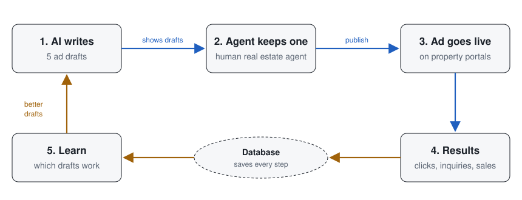
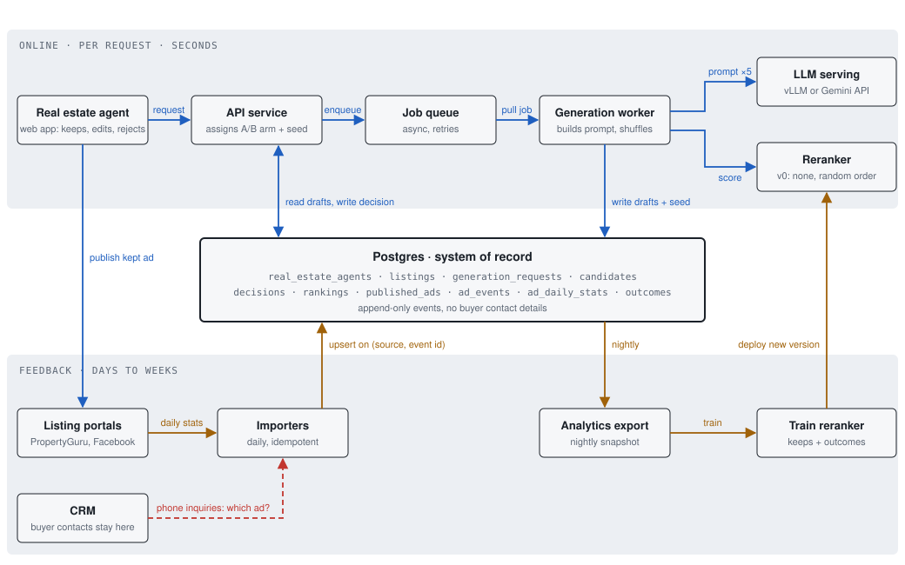

# Listing Ad Pipeline

An AI system that writes several ad versions for each property listing, records which version the human real estate agent keeps, and tracks how the published ad performs.

The goal is to learn from two signals at once: what real estate agents actually keep, and what actually brings in inquiries and sales. Prior research suggests people do not always choose the option they rate as best, so the system logs every draft, including the rejected ones.

**Status:** working MVP website (agent-side ad creation and buyer-side chat search) on top of the schema. The job queue, reranker and training loop in the design below are not built yet.

**Terminology:** in this project, *agent* always means a **human real estate agent**. The AI side is a language model called by a generation worker; nothing in this system is an autonomous AI agent.

## Design



The system runs on two clocks that share one Postgres database. In the detailed diagram below, **blue** is the online path (seconds) and **amber** is the feedback path (days to weeks).



- **Online path (seconds).** Real estate agent's app → API service → job queue → generation worker → language model, with an optional reranker. The worker stores every AI draft with its display position and shuffle seed. The real estate agent keeps one draft, edits it, writes their own, or rejects all of them.
- **Feedback path (days to weeks).** Ads are published on our own property portal, which logs views, clicks, inquiries and phone-number reveals first-hand. A nightly export trains the reranker, which is then redeployed.

The reranker starts as random order on purpose, so the first months of data show position effects before any model shapes what real estate agents see.

## How it works, in plain language

The system is two loops that share one filing cabinet.

### The fast loop (blue): seconds, while the real estate agent waits

1. **Real estate agent:** a person opens the app and asks for ad ideas for a listing.
2. **API service, the front desk:** receives the request. It also quietly decides which version of the system this person gets, the way a shop tests two window displays, and how the drafts will be shuffled.
3. **Job queue, the waiting line:** writing ads takes a few seconds, so requests wait in line instead of freezing the app. If something fails, the job is retried.
4. **Generation worker, the writer's assistant:** takes the next job and prepares the instructions for the AI.
5. **LLM serving, the AI itself:** writes five different ad drafts.
6. **Reranker, a judge (switched off at first):** later, it will score the drafts to predict which one the real estate agent will like. For now, drafts are shown in random order on purpose, to see whether real estate agents simply pick whatever appears first.
7. **The real estate agent** sees the five drafts, then keeps one, edits it, writes their own, or rejects them all.
8. **Publish:** the kept ad goes live on our own property portal.

### The filing cabinet (middle): Postgres

Everything is written down here: every draft, including the rejected ones, what the real estate agent chose, and how ads perform later. It is the single source of truth both loops share. Buyers' names and contact details are never stored here.

### The slow loop (amber): days and weeks, learning from results

1. **Our property portal:** records every buyer action on each ad as it happens: views, clicks, inquiries, and clicks to reveal the real estate agent's phone number. The number stays hidden until a buyer clicks, so phone interest is linked to the exact ad too.
2. **Event logger, the record keeper:** files each action once. If the same action is reported twice, it is only counted once.
3. **Analytics export:** every night, a copy of the data goes somewhere it can be studied without slowing down the app.
4. **Train reranker, the learning step:** looks at which drafts real estate agents kept and which ads brought in inquiries and sales, and learns what a good draft looks like.
5. **Deploy new version:** the improved judge is switched on in the fast loop, so future drafts get better.

## The website (MVP)

A FastAPI app with server-rendered pages, the Postgres schema above, and LangChain for the language-model calls (so the provider is one setting).

**Real estate agent side (`/agent`)**

1. The agent signs in, uploads 1 to 8 photos and writes two or three sentences in any language.
2. One multimodal model call (`app/ai/llm.py`, `write_ads`) returns a structured result:
   - the description's language and a faithful English version,
   - **photo checks**: places where the photos contradict, cannot confirm, or add to the description,
   - the **property card** (factory or warehouse, location, land and built-up size, power, ceiling height, tenure, price, feature tags),
   - three ad drafts in marketable English.
3. A **draft check** (a LangGraph graph, `app/ai/draft_graph.py`) compares every draft with the card, the description and the photo warnings. Drafts with unsupported claims are rewritten once and checked again; any that still fail are shown with a warning. Earlier versions and the claims found are stored with each draft (`candidates.raw_response.check`).
4. The review page shows the checks, the editable card, and the drafts in seeded random order. The agent keeps one (and edits it), writes their own, or asks for new drafts, and can optionally rank the drafts from most to least creative (`rankings`).
5. Publishing writes the decision (`kept`, `wrote_own` or `kept_none`), edit distance and time to decide, updates the card and puts the ad live.

If `LLM_FALLBACK_MODEL` is set, every call moves to that model when the main one fails, and `generation_requests.model_name` records the model(s) that actually answered. `TRACE_TO_LANGSMITH=1` sends traces to LangSmith with photos removed; it is refused outside local development because the privacy notice does not cover it.

**Built for factories, warehouses and land in Malaysia.** The property card and search cover the specs industrial buyers screen on: sale or rent, land area (acres), built-up area, ceiling height, power supply (amps or kVA; kVA is converted to amps for search, 1 kVA ≈ 1.39 A at 415 V three-phase), freehold or leasehold with years left, zoning (light, medium or heavy industrial, commercial, agricultural), 40-ft container access and loading bays. The model reads English, Malay and Chinese descriptions (e.g. *kilang*, *ekar*, *pegangan bebas*).

**Buyer side (`/`)**

- A **filter bar** for the main specs works as a plain form without JavaScript. With JavaScript it updates results in place, is sent with every chat message, and is rewritten from the chat's filters, so the two never disagree.
- A **map** (Leaflet with OpenStreetMap tiles; Leaflet is served from `/static`, not a CDN) shows every result. Agents set the exact site by dropping a pin on the review page; it starts at the named town's centre (`app/geo.py`).
- Listing pages have a **photo viewer** (thumbnails, arrows, swipe, keyboard, full-screen), a specifications table, land price per sqft, and a map.

- A chat box takes plain-language queries ("Factory in Shah Alam with 400 amp power and container access", then "freehold only"). The model calls a `search_listings` tool with structured filters (`SearchFilters`); the app runs a parameterised SQL query and shows the results as cards. The model never writes SQL and cannot invent listings.
- Listing pages hide the agent's phone number behind a button. Impressions, page opens and phone reveals go to `ad_events`, and the agent's dashboard shows the counts per listing.

**Search engine optimisation**

- **Landing pages for real search phrases:** `/factory-for-sale/shah-alam`, `/warehouse-for-rent/port-klang`, `/industrial-land-for-sale/johor` and so on, for every type, deal, town and state with listings. Each has its own title, heading and an intro written from the live listings (count, price range, land sizes, power, tenure, plus the Malay phrase, e.g. *Kilang untuk dijual di Shah Alam*). Empty ones are `noindex`.
- **Readable listing URLs** (`/listings/<id>/detached-factory-with-600a-power-in-shah-alam`); short or outdated links redirect permanently (301) to the one canonical URL.
- **Every public page** has a title, meta description, canonical link, Open Graph and Twitter tags (the cover photo is the preview image), and `lang="en-MY"`.
- **Structured data (JSON-LD):** `RealEstateListing` with price in MYR, address, map coordinates and specs on each listing; `BreadcrumbList` (eligible for breadcrumb rich results); `ItemList` on landing pages; `WebSite` on the home page.
- **`/sitemap.xml`** lists the home page, every listing (with photos, for Google Images) and every landing page with listings. **`/robots.txt`** blocks `/agent` and `/api/` and points to the sitemap.
- **Kept out of the index:** filter combinations (`/?min_power=...`, `noindex, follow`), agent pages (`X-Robots-Tag`), empty landing pages.
- **Speed (Core Web Vitals):** gzip, year-long caching of versioned static files and photos, image dimensions to prevent layout shift, first photo loaded with high priority and the rest lazily, and the map library loaded only on pages with a map.
- **Internal links:** breadcrumbs, "nearby" and "also in this area" links on landing pages, and a "popular searches" footer.

Set `SITE_URL` to the real domain when deploying, then submit `https://<domain>/sitemap.xml` in Google Search Console.

**Security measures**

Argon2 password hashing with login throttling; signed, HttpOnly, SameSite session cookies, rotated on sign-in; CSRF tokens on every agent form; JSON-only or custom-header buyer endpoints; a strict Content-Security-Policy with no inline scripts; photos decoded and re-encoded on upload, which rejects non-images and strips EXIF (including GPS); unpublished photos served only to their owner; parameterised SQL throughout; agents can only see their own requests.

**Out of scope for the MVP:** ad performance recommendations, the property management portal (payments), the job queue, the reranker.

### Run the website locally

```sh
cp .env.example .env              # set POSTGRES_PASSWORD, SESSION_SECRET and a model key
docker compose up -d              # Postgres with all migrations applied
python -m venv .venv && .venv/bin/pip install -r requirements.txt
.venv/bin/python -m scripts.seed_demo        # optional: 10 made-up industrial listings + demo login
.venv/bin/python -m scripts.create_agent --email you@example.com --name "Your Name" --phone "+00 0000 0000"
.venv/bin/uvicorn app.main:app --reload      # http://localhost:8000
```

Migrations run only when the database volume is first created. For an existing volume, apply new ones by hand, e.g. `docker compose exec -T db psql -U listing -d listing_ads -f - < db/migrations/V3__industrial_fields.sql`, or rebuild it: `docker compose down -v && docker compose up -d`.

OpenStreetMap's public tile server is fine for development and light use; for a busy production site, switch `MAP_TILES` in `app/main.py` to a commercial tile provider (their usage policy asks heavy users to).

Run the app tests (they create and drop a separate `listing_ads_test` database and use the offline stand-in model, so no API key is needed):

```sh
.venv/bin/python -m pytest tests
```

### Learning map

The code follows the concepts in the [Hugging Face Agents Course](https://huggingface.co/learn/agents-course/unit0/introduction), [LangChain docs](https://docs.langchain.com) and Chip Huyen's *AI Engineering*:

| Concept | Where |
|---|---|
| Multimodal input (images + text) | `LLMAssistant.write_ads`, `_image_block` |
| Structured output with a schema | `ListingAnalysis` in `app/ai/schemas.py`, `with_structured_output(..., method="json_schema")` |
| Tool calling and a bounded tool loop | `LLMAssistant.search_chat`: `create_agent` with `ModelCallLimitMiddleware`, `search_listings` tool |
| A graph with a loop and a check step | `app/ai/draft_graph.py` (LangGraph `StateGraph`) |
| Fallback models | `with_fallbacks` (ad writing), `ModelFallbackMiddleware` (search chat) |
| Tracing with redaction | `app/ai/tracing.py` (LangSmith, `hide_inputs`) |
| Conversation memory | chat history sent with each turn, capped at 12 messages |
| Grounding and guarding against hallucination | the model only sees tool results; SQL is built by the app |
| Prompt injection defence | descriptions and photos marked as data in the prompt; tools are read-only |
| Logging for evaluation | full prompt, raw response, display order and decisions stored per request |
| Swappable providers | `LLM_MODEL=provider:model` via `init_chat_model` |

## Repository layout

```
app/main.py                            web routes (buyer portal and agent pages)
app/ai/                                schemas, LangChain calls, offline stand-in
app/db.py, app/images.py, app/security.py
app/templates/, app/static/            pages, CSS, small JavaScript
scripts/                               create_agent, seed_demo
db/migrations/V1__initial_schema.sql   schema (first migration)
db/migrations/V2__website.sql          logins, property card, photos, analysis
db/migrations/V3__industrial_fields.sql  power, ceiling, land area, tenure, zoning, container access, map pin
app/geo.py                             Malaysian towns and industrial areas (approximate centres)
app/static/vendor/leaflet/             Leaflet 1.9.4 (BSD-2), checked against its published SRI hashes
tests/test_schema.sql                  constraint tests, rolled back after running
tests/test_app.py                      end-to-end website tests (pytest)
docker-compose.yml                     local Postgres with the schema applied
.env.example                           local settings template
docs/overview.svg                      simple five-step loop
docs/architecture.svg                  detailed system design
```

## Run the schema tests

Requires Docker.

```sh
cp .env.example .env                  # then set a password
docker compose up -d                  # starts Postgres and applies migrations
docker compose exec db sh -c 'psql -U "$POSTGRES_USER" -d "$POSTGRES_DB" -v ON_ERROR_STOP=1 -f /tests/test_schema.sql'
```

The tests print one `pass:` line per check and end with `All schema tests passed.` They run inside a transaction and leave no data behind.

Migrations run only when the database volume is first created. To rebuild from scratch: `docker compose down -v && docker compose up -d`.

## Schema decisions

1. **Rejected drafts are stored, not discarded.** Without them there is no way to tell whether real estate agents kept the draft they would rank highest.
2. **Display position and shuffle seed are logged.** This separates "real estate agents keep the best draft" from "real estate agents keep whatever appears first."
3. **Every decision is explicit:** `kept`, `kept_none` or `wrote_own`. A missing decision row means the request was abandoned. The database guarantees that a kept draft and any rankings belong to the same request.
4. **Events cannot double-count.** Events are keyed by their source and event ID, and daily rollups are upserted when a day is recomputed.
5. **The full prompt and raw model response are stored.** LLM output is not reproducible, so a version label alone cannot show what the real estate agent saw.
6. **No buyer personal data in these tables.** Inquiries are counted here; contact details stay in the CRM.
7. **Listings end explicitly.** `outcomes.status` is `sold`, `withdrawn` or `expired`; a price is required only for sales. No outcome row means the listing is still active.

## Open questions

- **Phone reveals as a signal.** The real estate agent's phone number is hidden until a buyer clicks to reveal it, and each reveal is logged against the ad. A reveal shows interest but does not confirm that a call happened. Is that good enough, or should calls be confirmed later?
- **Showing buyers different drafts.** Because we own the portal, different buyers could be shown different drafts of the same listing at random. That would test directly whether the draft the real estate agent kept is the one buyers respond to most. It needs the real estate agents' agreement and ethics approval first.
- **Late outcomes.** A sale lands weeks after the ad. How should late events join back to the request, and should training wait for them?
- **Model hosting.** Drafts for one listing share a long prompt. At this scale, is self-hosted serving (for example vLLM with prefix caching) worth it compared with an API?

## Data rules

- Never commit real client, buyer or listing data. Tests use made-up records only.
- The portal holds buyer data, so privacy law applies to it directly. Buyer contact details stay in the CRM, never in the research tables.
- Secrets live in `.env`, which is git-ignored.
- Never edit an applied migration. Add `V2__...`, `V3__...` instead.
