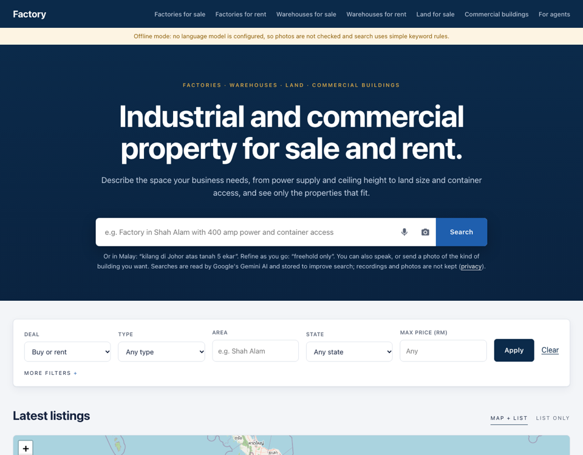
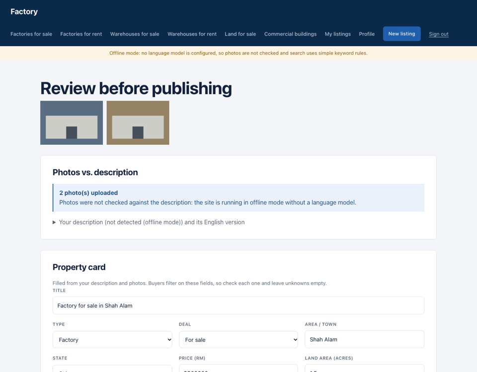
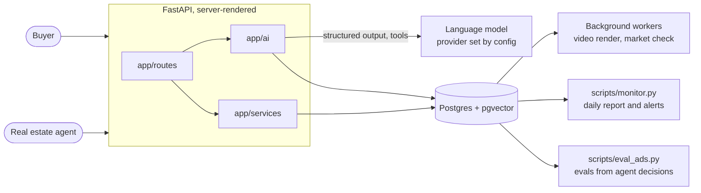

# Factory

[](https://github.com/jialincheoh/factory/actions/workflows/ci.yml)


A listings portal for factories, warehouses, land and commercial buildings, in production at
**[corpbiz.my](https://corpbiz.my)**.

Real estate agents upload photos and a short note, in English, Malay or Chinese. A language model fills in a
structured property card and writes ad drafts, a second pass checks every claim against the facts, and the agent
decides what gets published. Buyers search with filters or by chatting, speaking or sending a photo.

The engineering problem is **putting an unreliable model inside a product where a wrong claim about a property is
expensive**. The model proposes and ordinary code decides: it validates the output, builds the SQL, does the
arithmetic, and records what happened. A person approves every ad.

| Buyer search | Agent review |
|---|---|
|  |  |

The screenshots show the local demo in offline mode, with made-up data.

## Try it in one command

Needs Docker. No API key is required: `LLM_MODEL=offline` swaps the model for a rule-based stand-in.

```sh
docker compose up --build
```

Open <http://localhost:8000>. The agent side is at `/agent`; sign in with `demo@example.com` / `demo-password-123`.
The seed script that creates this account is for local use only.

## Architecture



It is one deployable with Postgres as its only stateful dependency. That covers listings, photos, videos, the
LangGraph checkpoints, vector search and the work queues, which is the right trade at this traffic. The limits of that choice
are written down in [the design decisions](docs/decisions.md).

More detail: [architecture](docs/architecture.md) · [design decisions](docs/decisions.md) ·
[security](docs/security.md) · [operations](docs/operations.md) · [search engine optimisation](docs/seo.md) ·
[ad scoring rubric](docs/ad-rubric.md) · [research design](docs/research-design.md)

## Worth a look

If you have ten minutes, these are the parts that carry the most engineering judgement.

| What | Where | Why it is interesting |
|---|---|---|
| Draft checking | [`app/ai/draft_graph.py`](app/ai/draft_graph.py) | A LangGraph fan-out checks each draft in its own branch and rewrites only those that fail, with a bounded loop. Model calls are injected as functions, so the graph is tested without a model. |
| Grounded market comparison | [`app/services/market.py`](app/services/market.py) | The agent is never told the listing's price. Code drops any comparable whose figures are not in the source it cites, and does all the arithmetic. |
| Bounded search chat | [`app/ai/llm.py`](app/ai/llm.py), [`app/db.py`](app/db.py) | The model calls a typed search tool. It never writes SQL and cannot invent listings. Out-of-scope requests end in a fixed reply. |
| Postgres as a work queue | [`app/services/video.py`](app/services/video.py) | Render jobs are claimed with a lease, so a crashed worker's job is retried. New photos invalidate old work through a content key. |
| Prompt change control | [`tests/test_ai.py`](tests/test_ai.py), [`scripts/monitor.py`](scripts/monitor.py) | Prompt text is fingerprinted and pinned to a version. A test fails if a prompt changes without a new version, and the monitor alerts if production ever disagrees. |
| Constraints in the schema | [`db/migrations`](db/migrations), [`tests/test_schema.sql`](tests/test_schema.sql) | The database itself rejects, for example, a kept draft from a different request. Events are idempotent by source and event ID. |

## Repository layout

```
app/
  main.py        Wiring: middleware, routers, error pages
  routes/        HTTP only, one module per area of the site
  services/      Business logic: ad records, tracking, photos, video, market check
  ai/            Model code: prompts, schemas, graphs, masking, call logging, offline stand-in
  web/           Shared HTTP helpers: templates, headers, form parsing
  templates/     Jinja pages (autoescaped)
  static/        CSS, a small JS file, vendored Leaflet
  db.py          Connections and the listing search query
  security.py    Passwords, sessions, CSRF, rate limits
  seo.py, geo.py Structured data, readable URLs, known places
db/migrations/   Versioned SQL, applied in order by scripts/migrate.py
scripts/         Operational commands: migrate, monitor, evals, seed, workers
tests/           Python tests and SQL constraint tests
deploy/          Google Cloud scripts (see Status)
docs/            Design documents
```

## Develop and test

Needs Python 3.12 and Docker. `make` lists every command.

```sh
make setup   # virtualenv, dependencies, .env
make db      # Postgres with migrations applied
make seed    # optional demo data
make run     # http://localhost:8000
```

```sh
make test    # Python tests, then SQL constraint tests
make lint    # ruff check and format
```

The tests run against real Postgres and pgvector in a throwaway database, using the offline model, so they need no
key and no network. There are 99 Python tests, including end-to-end journeys through the web layer, real ffmpeg renders,
and fake models for the provider fallback and tool loop. CI runs them on every push to `main` and every pull request, along with the lint
checks, migrations against an empty database, the constraint tests and a Docker image build.

To use a real model, set `LLM_MODEL=provider:model` and the matching key in `.env`. See [`.env.example`](.env.example).

**Stack:** FastAPI, Jinja, Postgres 16, pgvector, psycopg, LangChain, LangGraph, Deep Agents, Gemini, ffmpeg, Leaflet,
Docker, Render.

## Status

Plainly, what is and is not proven in production:

| Area | State |
|---|---|
| Portal, agent flow, search chat, SEO pages | Live on corpbiz.my, on Render's free plan |
| Video tours | Deployed and off by default. No production render has been observed yet. |
| Market check | Deployed but switched off. Needs search quota. Tested with sample search results, not real ones. |
| Google Cloud scripts in `deploy/` | Written but never run. Render is the real deployment. |
| Rate limits | Per process, in memory. See [the known limits](docs/security.md#known-limits). |
| Reranker and buyer experiments | Designed, not built. See [the research design](docs/research-design.md). |

## Licence

The source is public so that it can be read and evaluated. No open-source licence is granted; all rights reserved.
Leaflet, in `app/static/vendor/leaflet`, is BSD-2-Clause.
