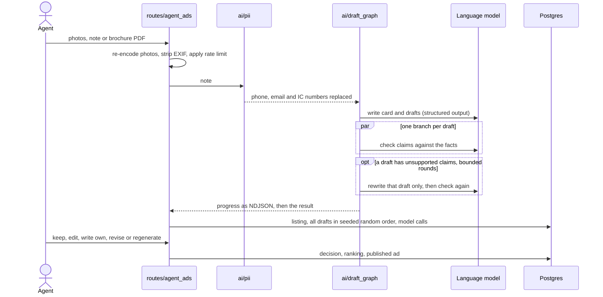
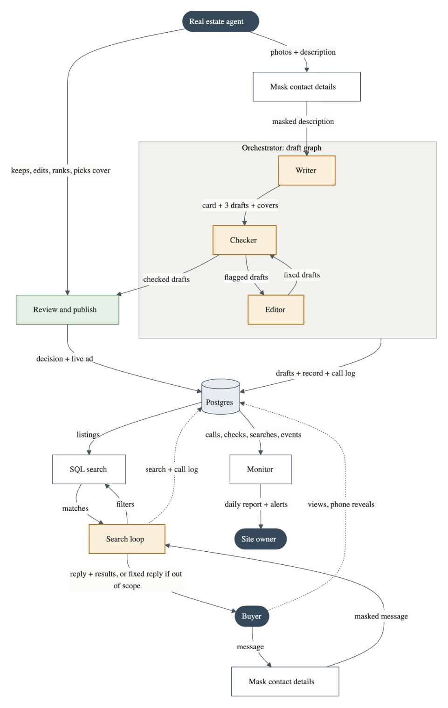
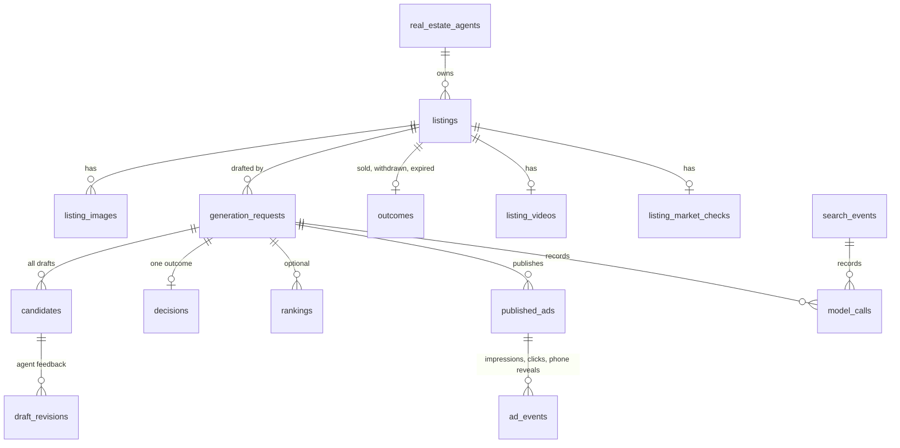

# Architecture

## Components

| Layer | Modules | Responsibility |
|---|---|---|
| HTTP | `app/routes`, `app/web` | Parse and validate requests, choose a response. No business rules. |
| Business logic | `app/services` | Ad records, tracking, photos, video tours, market checks, revisions, embeddings. |
| Model code | `app/ai` | Prompts, output schemas, graphs, contact masking, call logging, offline stand-in. |
| Data | `app/db.py`, `db/migrations` | One short-lived connection per request. Every query is parameterised. |
| Operations | `scripts` | Migrations, monitoring, evaluations, seed data, one-off workers. |

Pages are server-rendered with Jinja. The filter bar works as a plain form, and a small JavaScript file adds live
updates, the chat, the map and streamed progress. There is no build step.

## Writing an ad





Things to notice:

- **Nothing is saved until the model has answered**, so a failure leaves no half-created listing.
- **Drafts that still fail are shown with a warning.** The agent is the final check, and the flag is stored with the
  draft.
- **Feedback revisions resume a paused graph.** `app/ai/revise_graph.py` uses LangGraph's Postgres checkpointer, so a
  thread survives a restart.
- **Providers are interchangeable.** `LLM_MODEL=provider:model` goes through `init_chat_model`. With
  `LLM_FALLBACK_MODEL` set, calls move to the second model on failure and the model that actually answered is recorded.

## Searching

```mermaid
sequenceDiagram
    actor Buyer
    participant Route as routes/search_api
    participant Loop as Search loop
    participant Model as Language model
    participant DB as Postgres

    Buyer->>Route: message, plus the current filters
    Route->>Loop: masked history (12 messages at most)
    Loop->>Model: messages and tools
    Model-->>Loop: search_listings(typed filters)
    Loop->>DB: parameterised SQL built by the app
    DB-->>Loop: matches
    Loop->>Model: results
    Model-->>Route: reply, or decline_request with a fixed reply
    Route->>DB: search event, impressions, model calls
    Route-->>Buyer: reply, result cards, map markers, updated filter bar
```

- The filter bar and chat share one `SearchFilters` object, so they cannot disagree.
- Voice is transcribed first, so spoken words go through the same masking and logging as typed text. Audio and photos
  are not stored.
- With `EMBEDDINGS_MODEL` set, a described use such as "suitable for cold storage" ranks results by pgvector similarity.
  Hard filters still apply.

## Background work

Video tours and market checks take minutes, so they never run inside a request. Both follow the same pattern:

1. A worker thread started in the app's lifespan, or a `scripts/` command, finds the next due listing.
2. It claims the row with an atomic `INSERT ... ON CONFLICT DO UPDATE` that holds a time-limited lease, so a job whose
   server died becomes available again.
3. A content key, such as the set of photos or the price and size, tells it when finished work has gone stale.
4. Failures are bounded: a video gets a fixed number of attempts per set of photos, and a market check waits a day
   before trying again.

**Video tours** apply ffmpeg camera movement to the listing's real photos. No footage is generated, so a film cannot
show anything the photos do not.

**Market checks** use a Deep Agent to search and read, and code to decide what counts. See
[the design decisions](decisions.md#market-check-the-model-gathers-code-decides).

## Data model



`db/migrations` is the source of truth. `scripts/migrate.py` applies each file once, in numeric order and in its own
transaction, and records it in `schema_migrations`. Applied migrations are never edited.

## Observability

- **`model_calls`** holds one row per call: step, configured model, the model the provider says served it, whether a
  fallback ran, latency, tokens, prompt version and prompt hash.
- **`scripts/monitor.py`** reports from those rows and exits with status 1 when an alert fires. It covers failure and
  fallback rates, silent model changes, prompt edits without a new version, flagged drafts, and failed, declined or
  empty searches.
- **`scripts/eval_ads.py`** turns published listings into a labelled dataset, because the agent's corrections are ground
  truth for the card, and scores a model and prompt on it locally or in LangSmith.
- **[`ad-rubric.md`](ad-rubric.md)** defines how a draft is scored by hand.
