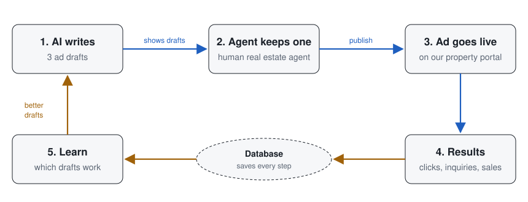

# Research design

This is the direction the system was designed towards. **The reranker, job queue and buyer experiments below are not
built.** What exists is the data they need: every draft, its display position, the agent's decision and how the ad
performed.

The question is whether what agents keep matches what buyers respond to. People do not always choose the option they rate
as best, so the system records choices, rankings and outcomes separately.

## Two clocks

- **Online, in seconds.** An agent asks for drafts, a worker calls the model, and an optional reranker orders them. The
  agent keeps one, edits it, writes their own, or rejects them all.
- **Feedback, in days to weeks.** The portal logs views, clicks and phone reveals first-hand. A nightly export trains
  the reranker, which is then redeployed.

The reranker starts as random order on purpose, so the first months of data show position effects before any model
shapes what agents see.

## Why the schema looks the way it does

1. **Rejected drafts are stored.** Otherwise there is no way to tell whether agents kept the draft they would rank highest.
2. **Display position and shuffle seed are logged.** This separates quality from position.
3. **Every decision is explicit:** `kept`, `kept_none` or `wrote_own`. A missing row means the request was abandoned. The
   database guarantees that a kept draft and any rankings belong to the same request.
4. **Events cannot double-count.** They are keyed by source and event ID, and daily rollups are upserted.
5. **The full prompt and raw response are stored,** because model output is not reproducible.
6. **No buyer personal data in these tables.** Inquiries are counted; contact details stay elsewhere.
7. **Listings end explicitly.** `outcomes.status` is `sold`, `withdrawn` or `expired`. No row means still active.

## Open questions

- **Phone reveals as a signal.** A reveal shows interest but does not confirm that a call happened. Is that enough, or
  should calls be confirmed later?
- **Showing buyers different drafts.** Owning the portal makes randomising drafts possible, which would test directly
  whether the kept draft is the one buyers respond to. It needs the agents' agreement and ethics approval first.
- **Late outcomes.** A sale lands weeks after the ad. How should late events join back to the request, and should training
  wait for them?
- **Model hosting.** Drafts for one listing share a long prompt. At this scale, is self-hosted serving with prefix caching
  worth it compared with an API?

## Data rules

- Never commit real client, buyer or listing data. Tests use made-up records only.
- Buyer contact details never go into the research tables.
- The operator also runs the site, so research use of this data needs ethics review.
